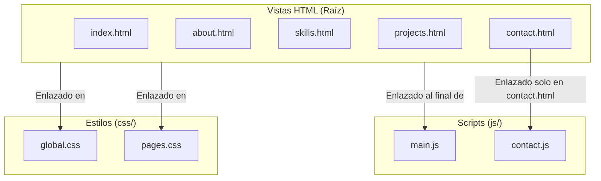

# Proyecto de Clase: Portafolio Web Personal (HTML, CSS y JS Puro)

Este documento define la **arquitectura oficial, reglas técnicas y guía de construcción** del proyecto de Portafolio Web Personal.
> **Para el alumno:** Puedes compartir este archivo `README.md` directamente con tu Agente de IA o copiar el bloque de la sección final para que te guíe y asista respetando exactamente la misma estructura vista en clase.

---

## 1. Objetivo del Proyecto

Desarrollar un sitio web personal de **5 páginas independientes** que compartan una misma identidad visual (encabezado, menú de navegación, paleta de colores, tipografía y pie de página), utilizando únicamente tecnologías web nativas.

---

## 2. Reglas Técnicas Estrictas (Restricciones)

Tanto el estudiante como cualquier Agente de IA que asista en el código deben cumplir estas reglas:

1. **Solo tecnologías nativas**: Únicamente **HTML5**, **CSS3** y **JavaScript puro (Vanilla JS)**.

2. **Sin frameworks ni librerías**: No usar Bootstrap, Tailwind, React, Vue, jQuery ni plantillas externas.

3. **Sin backend**: Toda la funcionalidad debe ejecutarse en el navegador del cliente.

4. **Sitio Multipágina (MPA)**: Cada sección principal debe ser un archivo `.html` independiente (no construir todo en una sola página de scroll largo).

5. **Convención de idioma**:

   * **Nombres de archivos, carpetas, IDs y clases CSS**: en **inglés** (`index.html`, `about.html`, `.nav-menu`, `.project-card`).

   * **Contenido visible para el visitante y comentarios del código**: en **español**.

---

## 3. Arquitectura Oficial de Carpetas y Archivos

El proyecto debe respetar exactamente la siguiente estructura:

```text

portfolio-web/

│

├── README.md               # Especificación y guía del proyecto

├── index.html              # Página 1: Inicio (Presentación y resumen)

├── about.html              # Página 2: Sobre mí (Biografía, trayectoria y CV)

├── skills.html             # Página 3: Habilidades (Técnicas, herramientas y blandas)

├── projects.html           # Página 4: Proyectos (Galería de tarjetas de proyectos)

├── contact.html            # Página 5: Contacto (WhatsApp, LinkedIn, Correo y formulario)

│

├── css/

│   ├── global.css          # Variables (:root), reset, botones, header, nav y footer

│   └── pages.css           # Estilos específicos del contenido (<main>) de cada página

│

├── js/

│   ├── main.js             # Lógica global (menú móvil, enlace activo y año del footer)

│   └── contact.js          # Lógica de contacto (copiar correo, validar form, enviar a WhatsApp/mailto)

│

└── assets/

    ├── img/                # Foto de perfil e imágenes de proyectos

    └── docs/               # Currículum Vitae en PDF para descarga

```

---

## 4. Responsabilidad y Relación entre Archivos



### A. Estructura Compartida en los 5 Archivos HTML

Todos los archivos `.html` deben tener **exactamente el mismo bloque `<header>` y `<footer>`**, cambiando únicamente el contenido dentro de `<main>`:

* **`<head>`**: Enlaza siempre `css/global.css` primero y `css/pages.css` después.

* **`<header class="site-header">`**: Contiene `<nav class="navbar container">` con:

  * El logo (`<a href="index.html" class="logo">`).

  * El botón de menú móvil (`<button class="menu-toggle" id="menu-toggle">`).

  * La lista de navegación (`<ul class="nav-menu" id="nav-menu">`) con enlaces a `index.html`, `about.html`, `skills.html`, `projects.html` y `contact.html`.

* **`<main>`**: Contenido propio de cada página.

* **`<footer class="site-footer">`**: Derechos de autor con `<span id="current-year"></span>` y enlaces rápidos a redes.

---

### B. Especificación de Cada Vista HTML

1. **`index.html` (Inicio)**:

   * **Sección Hero (`.hero`)**: Saludo, título con nombre y rol, descripción breve, botones de acción (*Ver proyectos* hacia `projects.html` y *Contáctame* hacia `contact.html`), e imagen o avatar de perfil.

   * **Sección Resumen (`.highlights-grid`)**: 3 tarjetas (`.highlight-card`) destacando fortalezas clave.

2. **`about.html` (Sobre mí)**:

   * **Cuadrícula de 2 columnas (`.about-grid`)**:

     * Tarjeta izquierda: Biografía personal y botón para descargar el CV (`<a href="assets/docs/..." download>`).

     * Tarjeta derecha: Línea de tiempo (`.timeline-list` y `.timeline-item`) con formación académica y experiencia.

3. **`skills.html` (Habilidades)**:

   * **Cuadrícula (`.skills-grid`)**: Tarjetas por categoría (`.skill-category`), por ejemplo: *Desarrollo Frontend*, *Herramientas* y *Habilidades Blandas*.

   * Cada habilidad (`.skill-item`) muestra nombre, porcentaje y una barra de progreso visual con CSS (`.progress-bar` > `.progress-fill`).

4. **`projects.html` (Proyectos)**:

   * **Cuadrícula (`.projects-grid`)**: Mínimo 3 tarjetas de proyectos (`.project-card`).

   * Cada tarjeta incluye imagen (`.project-img`), título, descripción, etiquetas de tecnologías usadas (`.badge`) y enlaces a Demo y Código.

5. **`contact.html` (Contacto)**:

   * **Columna izquierda (`.contact-channels`)**: 3 tarjetas de contacto directo (`.channel-card`):

     * **WhatsApp**: Enlace directo con `https://wa.me/NUMERO?text=...` (`target="_blank"`).

     * **LinkedIn**: Enlace directo al perfil profesional (`target="_blank"`).

     * **Correo Electrónico**: Enlace `mailto:...` y un botón `<button id="copy-email-btn">` para copiar el correo al portapapeles.

   * **Columna derecha (`.contact-form-card`)**: Formulario `<form id="contact-form">` con campos `name`, `email`, `subject`, `message`, contenedor de alertas `#form-feedback` y dos botones de envío: **Enviar por Correo** y **Enviar por WhatsApp** (`#send-whatsapp-btn`).

---

### C. Hojas de Estilo (`css/`)

* **`css/global.css`**:

  * Define variables en `:root` para colores (`--color-bg`, `--color-surface`, `--color-primary`, `--color-secondary`, `--color-text`, etc.), tipografía (`--font-main`), bordes y sombras.

  * Incluye reset universal (`* { margin: 0; padding: 0; box-sizing: border-box; }`).

  * Define clases utilitarias reutilizables: `.container`, `.section`, `.section-header`, `.section-tag`, `.section-title`, `.btn`, `.btn-primary`, `.btn-outline`, `.badge`.

  * Define el diseño del Header, Navbar, estado `.nav-link.active`, Footer y Media Queries para ocultar/mostrar `.nav-menu.open` en pantallas menores a `768px`.

* **`css/pages.css`**:

  * Contiene los estilos específicos de `.hero`, `.highlights-grid`, `.about-grid`, `.timeline-list`, `.skills-grid`, `.progress-bar`, `.projects-grid`, `.contact-grid` y el formulario.

---

### D. Lógica en JavaScript (`js/`)

* **`js/main.js`** (Cargado en todas las páginas):

  1. **Menú móvil**: Escucha el evento `click` en `#menu-toggle` y alterna la clase `.open` en `#nav-menu`.

  2. **Enlace activo**: Lee `window.location.pathname` y asigna automáticamente la clase `.active` al `.nav-link` que corresponda al archivo HTML actual.

  3. **Año dinámico**: Inserta `new Date().getFullYear()` en `#current-year`.

* **`js/contact.js`** (Cargado solo en `contact.html`):

  1. **Copiar correo**: Usa `navigator.clipboard.writeText()` al hacer clic en `#copy-email-btn` y cambia temporalmente el texto del botón a `"¡Correo copiado!"`.

  2. **Validación**: Verifica que `name`, `email`, `subject` y `message` no estén vacíos y que el correo tenga formato válido antes de enviar, mostrando mensajes en `#form-feedback`.

  3. **Envío sin backend**:

     * Al enviar por correo (`submit`), construye una URL `mailto:` con `encodeURIComponent()` y abre el cliente de correo.

     * Al hacer clic en `#send-whatsapp-btn`, construye una URL `https://wa.me/NUMERO?text=...` con los datos del formulario y la abre en una nueva pestaña.

---

## 5. Plan de Trabajo Paso a Paso para Clase

1. **Fase 1 — Esqueleto HTML y Navegación**: Crear las carpetas y los 5 archivos `.html` con el `<header>`, `<nav>` y `<footer>` compartidos. Verificar que los enlaces permitan navegar entre las 5 páginas.

2. **Fase 2 — Identidad Visual (`css/global.css`)**: Configurar las variables en `:root` y dar estilo a la barra de navegación, botones y pie de página.

3. **Fase 3 — Contenido y Maquetación (`css/pages.css`)**: Completar el `<main>` de cada vista aplicando Flexbox y CSS Grid.

4. **Fase 4 — Interactividad (`js/main.js` y `js/contact.js`)**: Programar el menú hamburguesa, el botón de copiar correo y el formulario conectado a WhatsApp y Correo.

5. **Fase 5 — Personalización**: Reemplazar los textos, colores, enlaces de LinkedIn, número de WhatsApp, correo, proyectos e imágenes por los datos reales de cada estudiante.

---

## 6. Prompt para el Agente de IA del Estudiante

Si utilizas un asistente o agente de IA para apoyarte durante el desarrollo, cópiale el siguiente prompt o pídele que lea este archivo `README.md`:

```text

Actúa como mi tutor y asistente de desarrollo web. Estoy construyendo un proyecto académico de Portafolio Web Personal siguiendo la arquitectura definida en el archivo README.md de este proyecto.

Reglas obligatorias que debes respetar siempre:

1. Usa únicamente HTML5 semántico, CSS3 (Variables, Flexbox, CSS Grid, Media Queries) y JavaScript puro (Vanilla JS). No uses frameworks ni backend.

2. Mantén exactamente la estructura de 5 páginas independientes (index.html, about.html, skills.html, projects.html, contact.html), 2 hojas de estilo (css/global.css y css/pages.css) y 2 scripts (js/main.js y js/contact.js).

3. Todas las páginas deben compartir exactamente el mismo <header>, <nav> y <footer>.

4. En contact.html incluye canales directos de WhatsApp (wa.me), LinkedIn, Correo (mailto + botón para copiar correo con JavaScript) y un formulario validado que permita enviar el mensaje por Correo o WhatsApp.

5. Explícame paso a paso cada fragmento de código para que pueda comprender cómo funciona y personalizarlo con mis propios datos.

```

 